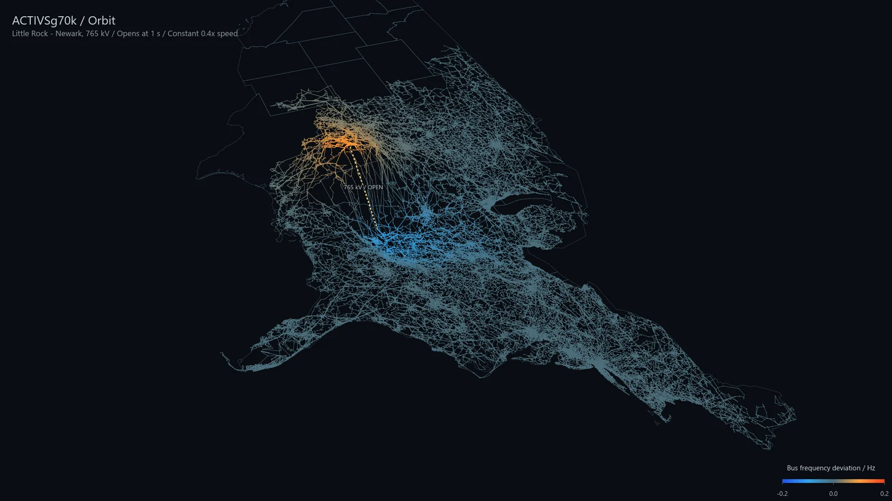
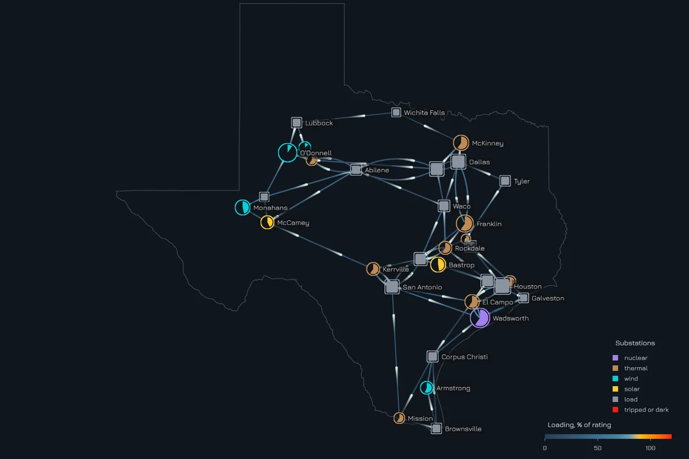
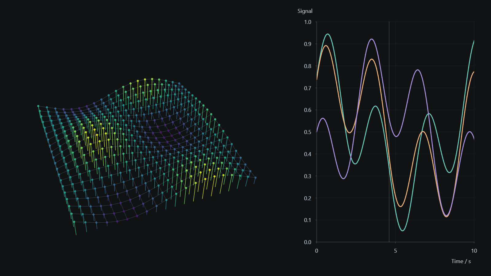
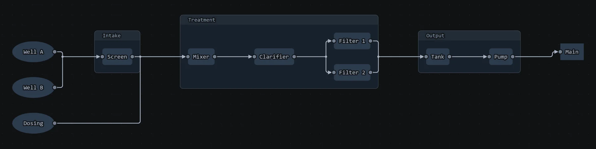
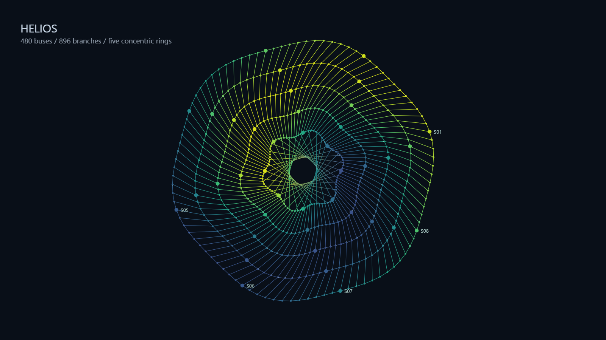
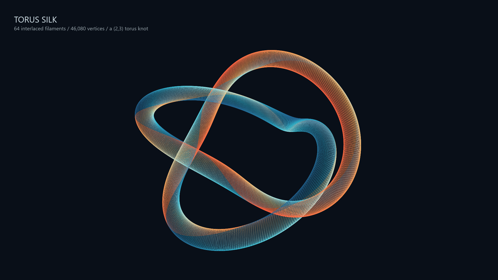
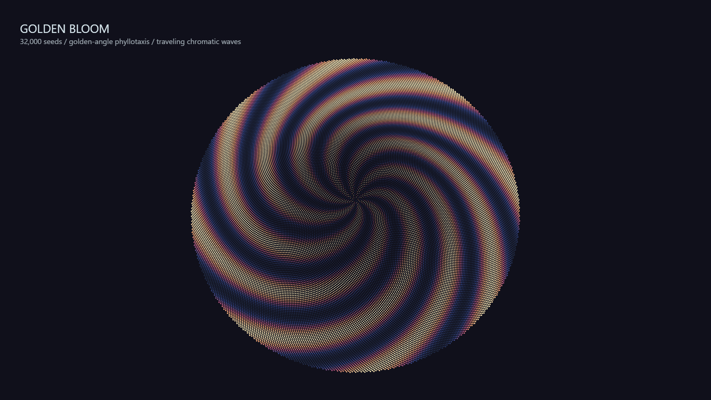

<p align="center">
  
</p>

<h1 align="center">latkit</h1>

<p align="center">
  Networks, maps, plots, and diagrams of millions of rows, drawn on the GPU:<br>
  in the browser with WebGPU, and as pictures and video from the command line.
</p>

<p align="center">
  <a href="https://github.com/lukelowry/latkit/actions/workflows/ci.yml"></a>
  <a href="https://www.npmjs.com/package/latkit"></a>
  <a href="https://crates.io/crates/latkit"></a>
  <a href="https://docs.rs/latkit"></a>
  <a href="https://latkit.readthedocs.io"></a>
  <a href="https://crates.io/crates/latkit"></a>
  <a href="LICENSE"></a>
</p>

## Install

```sh
npm install latkit          # in the browser
cargo install latkit-cli    # on the command line: pictures and video
cargo add latkit            # in Rust
```

## In the browser

```ts
import { loadLatkit, Patch, field, type Scene } from 'latkit';

const { Data, Gpu } = await loadLatkit();
const data = new Data('grid').apply(
  new Patch().replace('Bus', [101, 102], { x: [0, 30], y: [0, 20], kv: [230, 115] }),
);
const scene: Scene = {
  space: 'plane',
  marks: [
    {
      vertices: {
        of: ['grid', 'Bus'],
        position: ['x', 'y'],
        radius: 6,
        color: field('kv').colormap('viridis'),
      },
    },
  ],
};

const gpu = await Gpu.create();
const view = gpu.view(scene);
gpu.canvas(document.querySelector('canvas')!).show([view]);
view.setData(data);
view.fit();
```

Scenes, expressions, and patches are plain data, typed from latkit's schema: `latkit/core` builds
them without loading WebAssembly, in a worker or on a server.

## On the command line

The same scene and data, as JSON, render to a picture, or with `--frames` to video:

```sh
latkit render scene.json --data grid.json --output grid.png
latkit render scene.json --data grid.json --frames frames.jsonl --fps 60 --output grid.mp4
```

<details>
<summary><code>scene.json</code> and <code>grid.json</code></summary>

`scene.json`

```json
{
  "space": "plane",
  "marks": [
    {
      "vertices": {
        "of": ["grid", "Bus"],
        "position": ["x", "y"],
        "radius": 6,
        "color": { "colormap": "viridis", "value": { "field": "kv" } }
      }
    }
  ]
}
```

`grid.json`

```json
{
  "name": "grid",
  "patch": [
    {
      "replace": {
        "table": "Bus",
        "ids": [101, 102],
        "fields": { "x": [0, 30], "y": [0, 20], "kv": [230, 115] }
      }
    }
  ]
}
```

</details>

## Gallery

<p align="center">
  <a href="npm/examples/src/examples/power-flow"></a>
  <a href="npm/examples/src/examples/linked-views"></a>
  <a href="npm/examples/src/examples/diagram"></a>
  <a href="crates/latkit-cli/examples/cli-gallery"></a>
  <a href="docs/images/torus-silk.png"></a>
  <a href="docs/images/golden-bloom.png"></a>
</p>

<p align="center">
  <sub>From the <a href="npm/examples">example pages</a> and the <a href="crates/latkit-cli/examples">command-line examples</a>, with Torus Silk and Golden Bloom rendered using the published latkit-cli and npm latkit 0.2.0 releases.</sub>
</p>

## Repository

| Part                              | What it is                                                     |
| --------------------------------- | -------------------------------------------------------------- |
| [`latkit`](crates/latkit)         | The Rust library: data, expressions, scenes, views, and video  |
| [npm `latkit`](npm)               | The library in the browser, with types for every scene         |
| [`latkit-cli`](crates/latkit-cli) | Pictures and video of scenes, from JSON or binary data         |
| [Examples](npm/examples)          | Every feature on a page, and the browser gate that drives them |
| [Benchmark](benchmark)            | Every scenario's phases up its sizes, held to committed work   |
| [Docs](docs)                      | The guides, on [Read the Docs](https://latkit.readthedocs.io)  |

The `@latkit/*` TypeScript packages, a lighter alternative without WebAssembly, are maintained on
the [`npm/js`](https://github.com/lukelowry/latkit/tree/npm/js) branch.

## Develop

Requires Rust (pinned in `rust-toolchain.toml`), Node.js 24, and pnpm 10.30.

```sh
pnpm install
cargo xtask examples --open   # the example pages at http://127.0.0.1:5200
cargo xtask check             # format, lint, test, typecheck, and the browser gate
cargo xtask bench --quick     # every benchmark scenario once, at its smallest size
```

Created by [Luke Lowery](https://lukelowry.github.io/). [MIT License](LICENSE).
