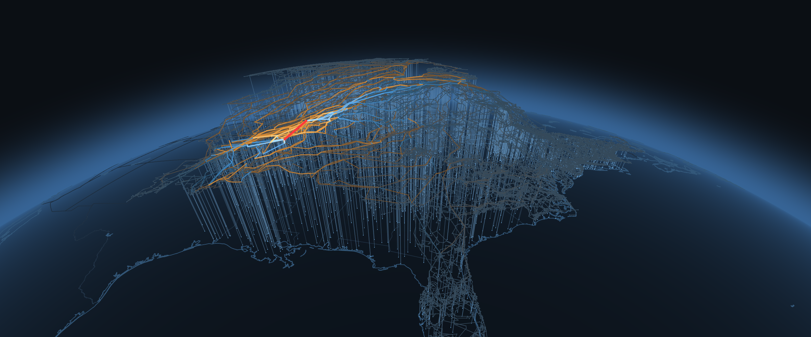
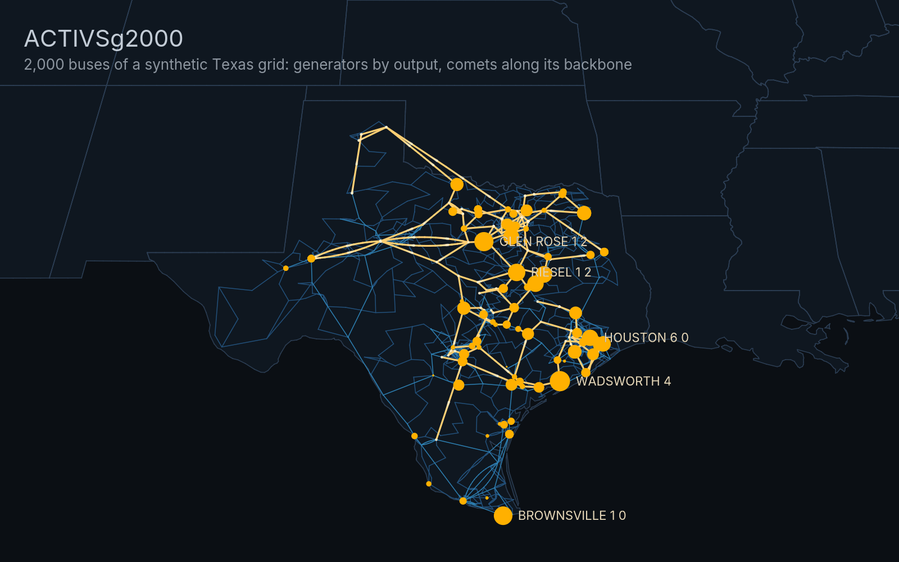
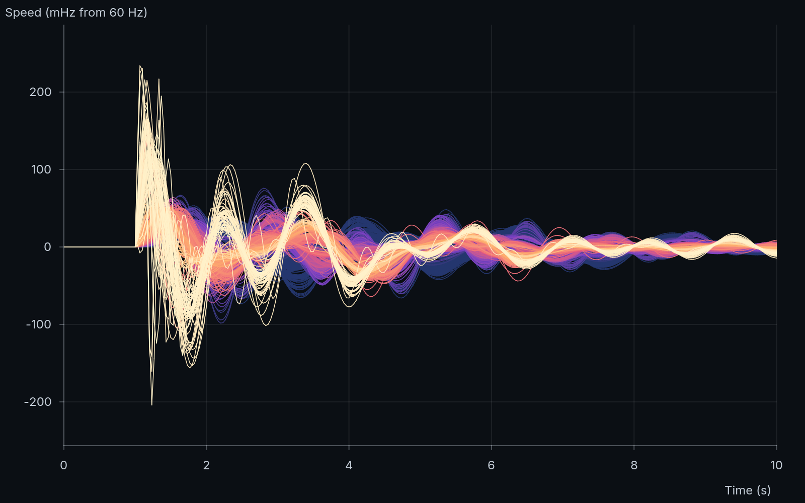
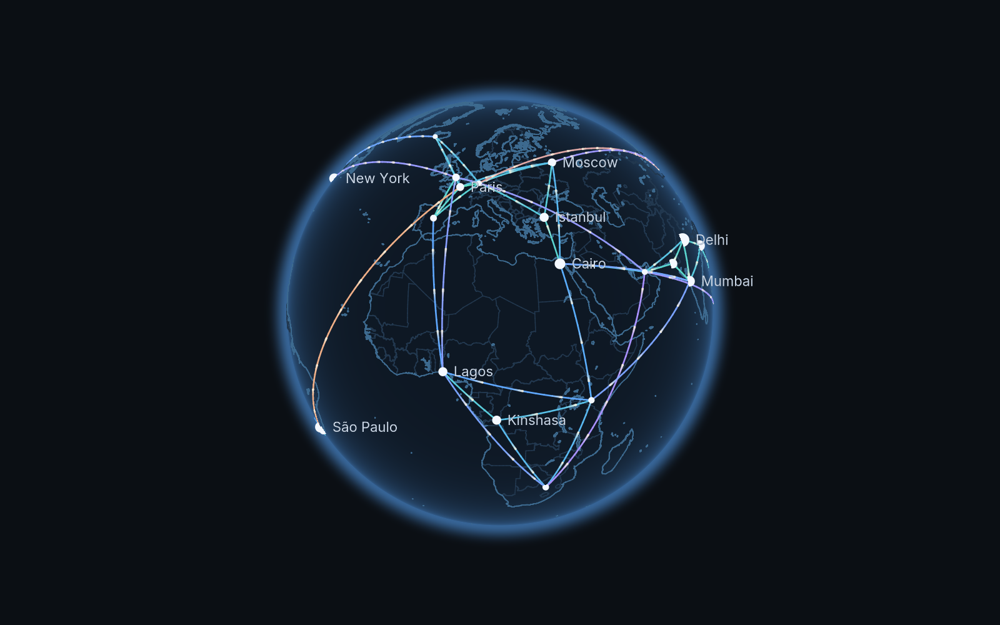
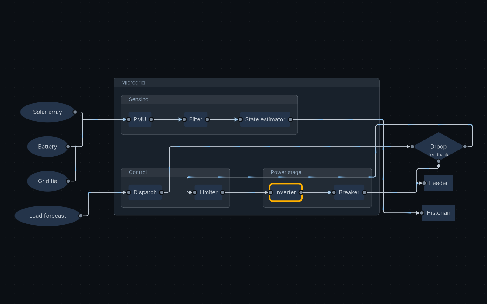
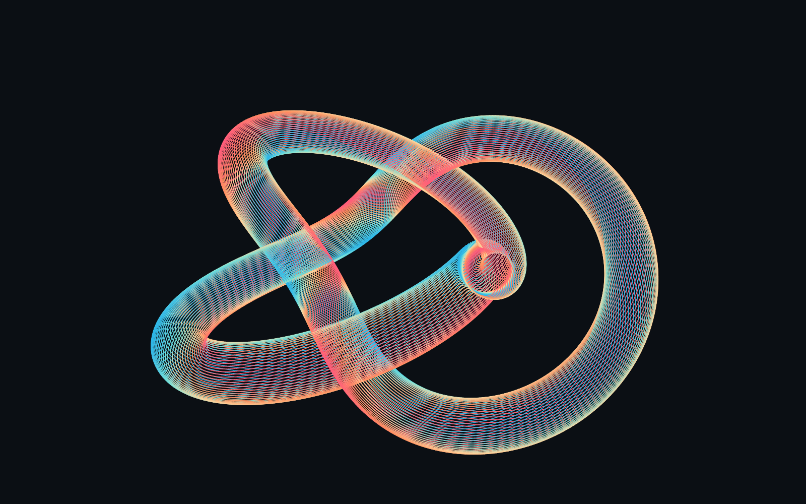
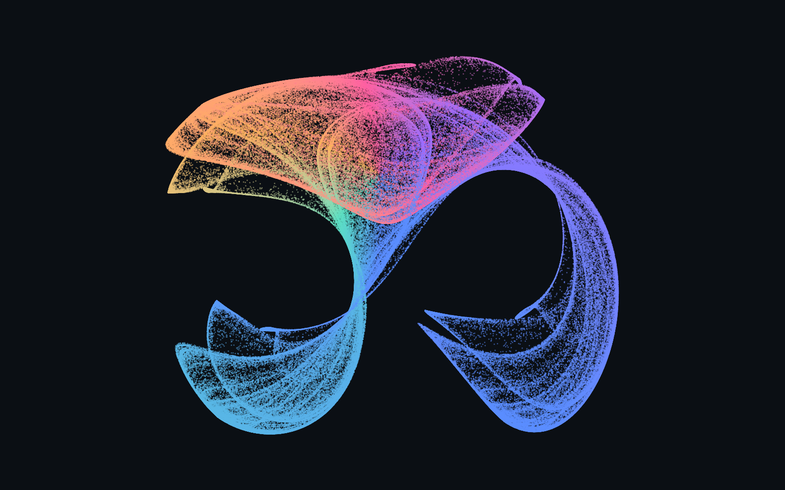

<p align="center">
  
</p>

<h1 align="center">
  <picture>
    <source media="(prefers-color-scheme: dark)" srcset="docs/_static/logo-dark.svg">
    
  </picture>
  latkit
</h1>

<p align="center">
  A GPU-accelerated visualization library for large networks, such as power grids:<br>
  interactive views in the browser with WebGPU, and images and video from the command line.
</p>

<p align="center">
  <a href="https://github.com/lukelowry/latkit/actions/workflows/ci.yml"></a>
  <a href="https://www.npmjs.com/package/latkit"></a>
  <a href="https://crates.io/crates/latkit"></a>
  <a href="https://docs.rs/latkit"></a>
  <a href="https://latkit.readthedocs.io"></a>
  <a href="https://crates.io/crates/latkit"></a>
  <a href="LICENSE"></a>
</p>

## Install

```sh
npm install latkit          # in the browser
cargo install latkit-cli    # on the command line: pictures and video
cargo add latkit            # in Rust
```

## In the browser

```ts
import { Data, View, field, load } from 'latkit';

await load();
const grid = new Data('grid').set('Bus', [101, 102], { x: [0, 30], y: [0, 20], kv: [230, 115] });

const view = await View.create(document.querySelector('canvas')!, {
  space: 'plane',
  marks: [
    {
      vertices: grid.table('Bus'),
      position: ['$x', '$y'],
      radius: 6,
      color: field('kv').colormap('viridis'),
    },
  ],
});

grid.set('Bus', [102], { kv: [345] }); // drawn the next frame
```

A scene is plain data, with types from latkit's schema. `JSON.stringify(scene)` writes the JSON the
command line reads.

## On the command line

Write the same scene and data as JSON to render a picture, or a video with `--frames`:

```sh
latkit render scene.json --data grid.json --output grid.png
latkit render scene.json --data grid.json --frames frames.jsonl --fps 60 --output grid.mp4
```

<details>
<summary><code>scene.json</code> and <code>grid.json</code></summary>

`scene.json`

```json
{
  "space": "plane",
  "marks": [
    {
      "vertices": ["grid", "Bus"],
      "position": ["$x", "$y"],
      "radius": 6,
      "color": { "colormap": "viridis", "value": "$kv" }
    }
  ]
}
```

`grid.json`

```json
{
  "name": "grid",
  "patch": [
    {
      "replace": {
        "table": "Bus",
        "ids": [101, 102],
        "fields": { "x": [0, 30], "y": [0, 20], "kv": [230, 115] }
      }
    }
  ]
}
```

</details>

## Gallery

<p align="center">
  <a href="https://latkit.readthedocs.io/en/latest/examples/texas.html"></a>
  <a href="https://latkit.readthedocs.io/en/latest/examples/frequency.html"></a>
  <a href="https://latkit.readthedocs.io/en/latest/examples/globe.html"></a>
  <a href="https://latkit.readthedocs.io/en/latest/examples/diagram.html"></a>
  <a href="https://latkit.readthedocs.io/en/latest/examples/torus.html"></a>
  <a href="https://latkit.readthedocs.io/en/latest/examples/clifford.html"></a>
</p>

latkit drew every picture here. [The examples](https://latkit.readthedocs.io/en/latest/examples/) show the code for each one.

## Documentation

Guides, examples, and the reference are on [Read the Docs](https://latkit.readthedocs.io), and the
Rust API is on [docs.rs](https://docs.rs/latkit). [Contributing](CONTRIBUTING.md) covers the
repository and how to build it.

Created by [Luke Lowery](https://lukelowry.github.io/). [MIT License](LICENSE).
