# Example gallery

## Power system studies

:::{container} cards
[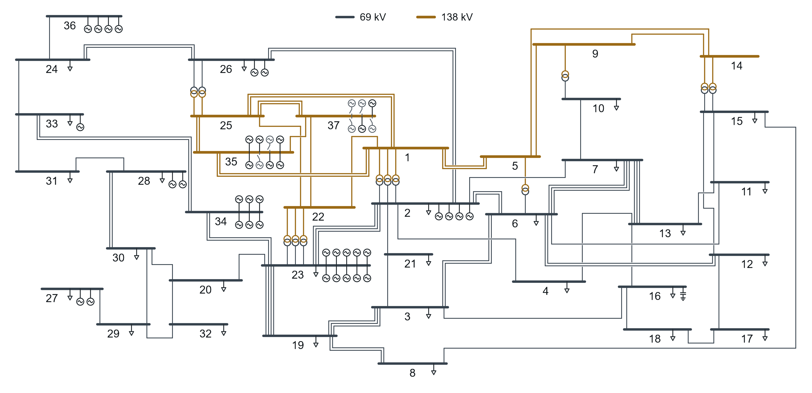 Draw the Hawaiʻi one-line](hawaii.md)

[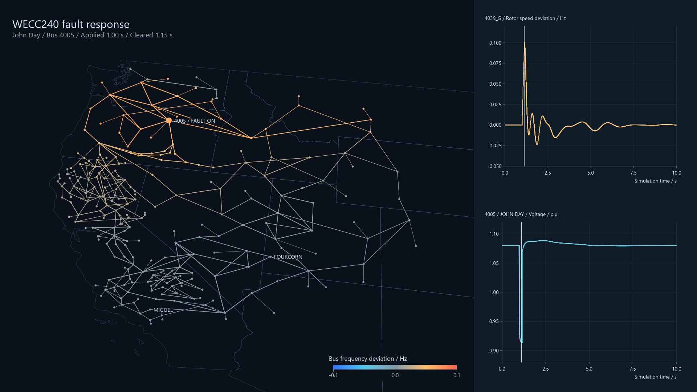 Compare a map and two fault traces](wecc.md)

[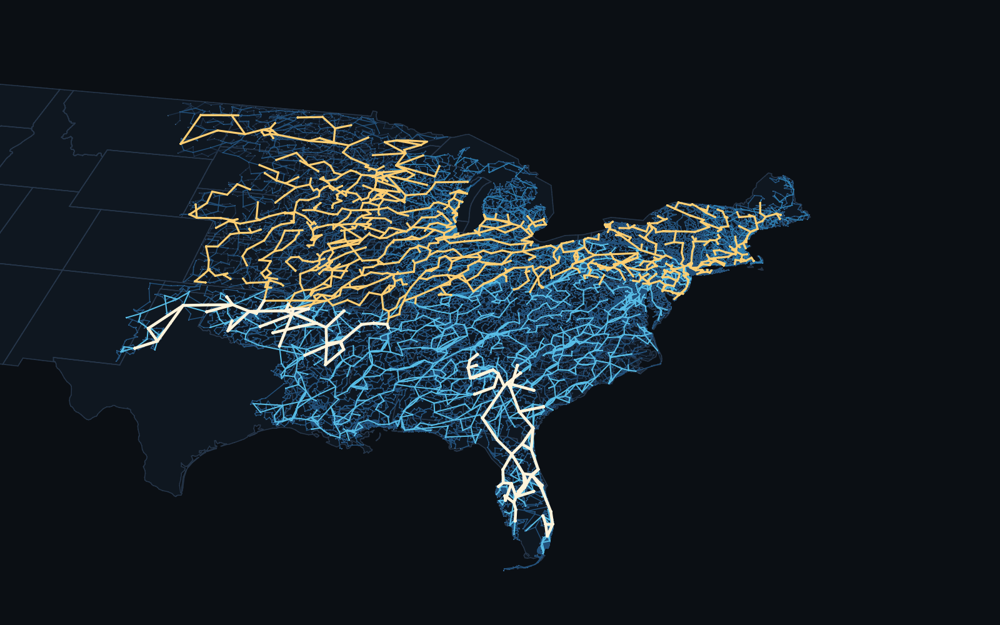 Map a large power grid](grid.md)

[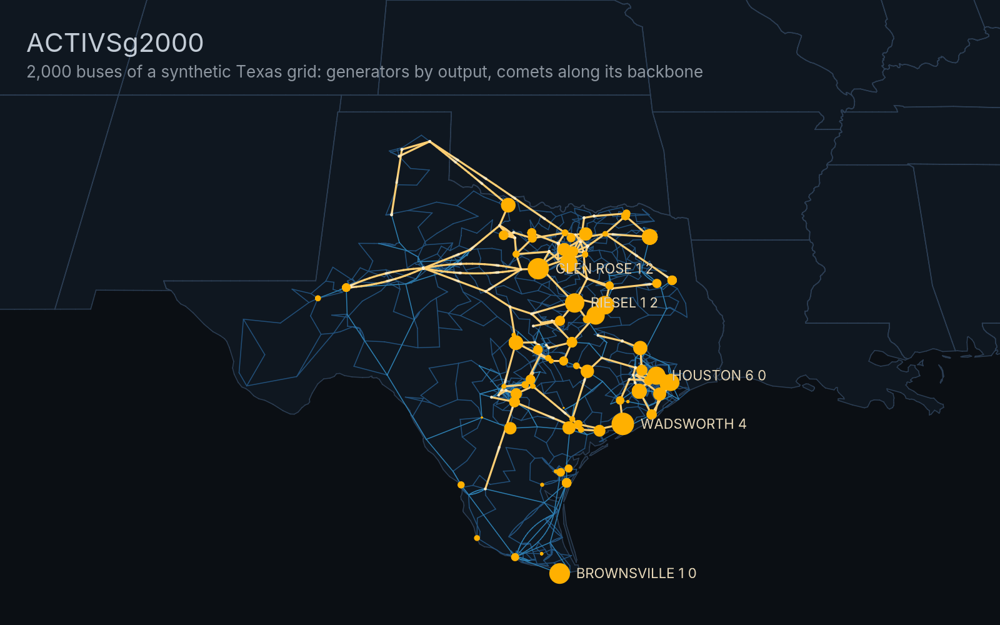 Map generation by bus](texas.md)

[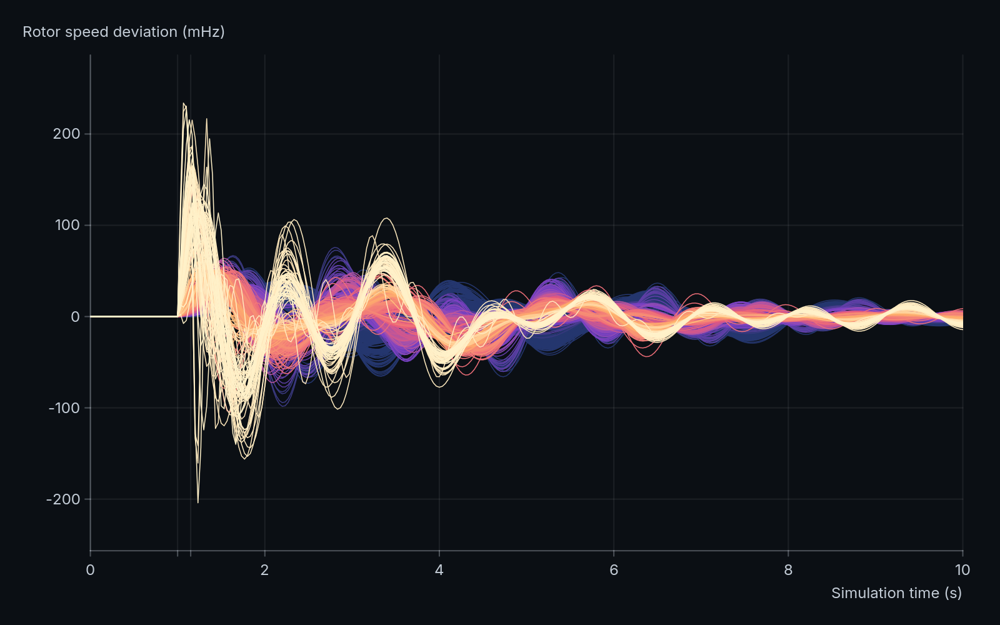 Plot rotor speed after a fault](frequency.md)

[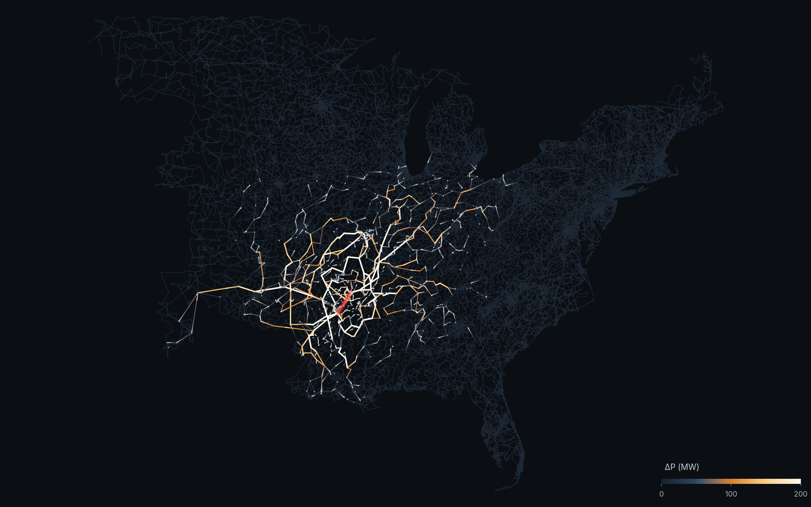 Trace power after a line opens](rerouting.md)

[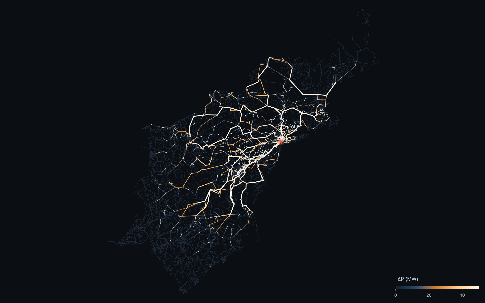 Track power flows during a fault](fault.md)
:::

## Monitors

:::{container} cards
[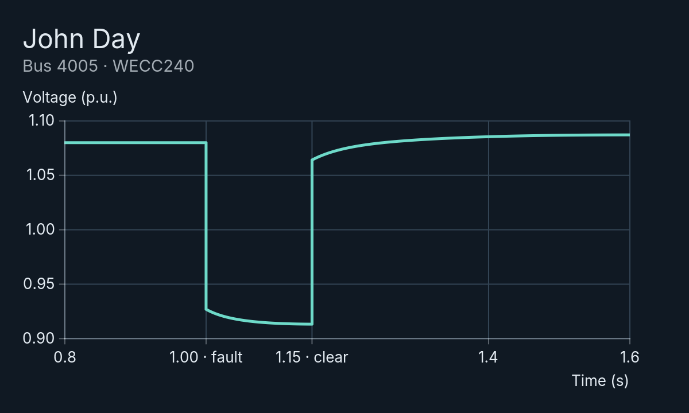 Bus voltage during a fault](voltage-dip.md)

[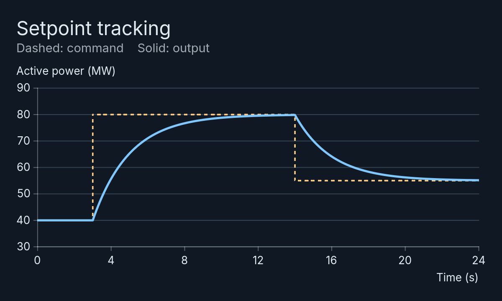 Setpoint and response](step-response.md)
:::

## Maps, geometry and motion

:::{container} cards
[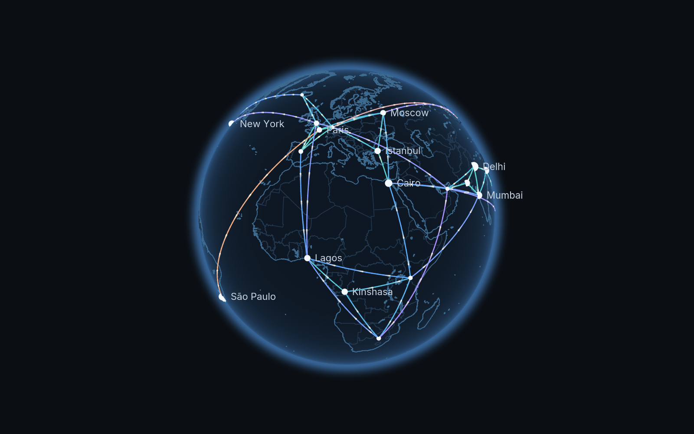 Draw great-circle routes](globe.md)

[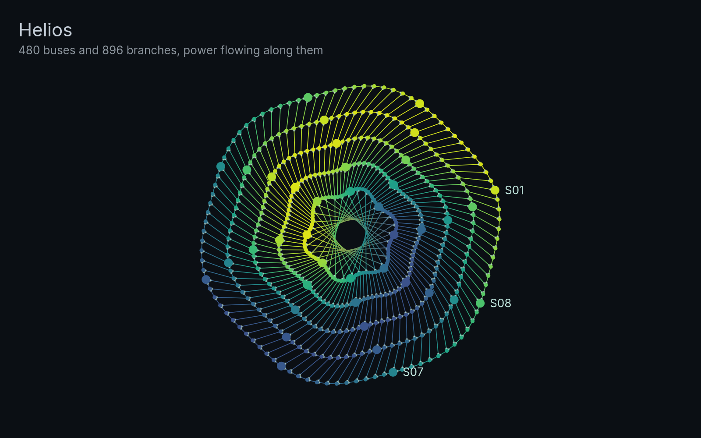 Connect a network in rings](helios.md)

[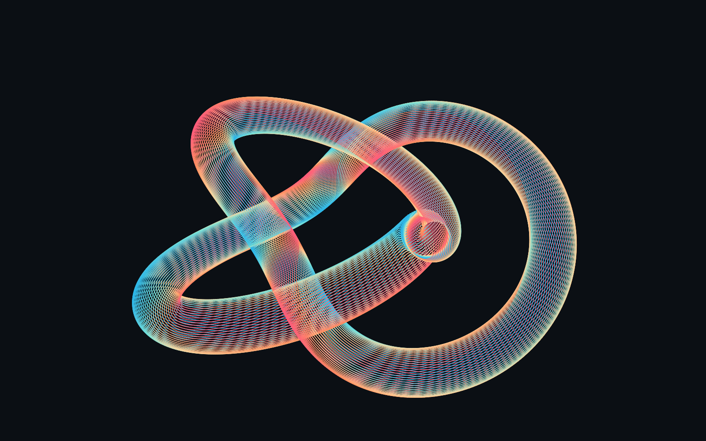 Draw a torus knot](torus.md)

[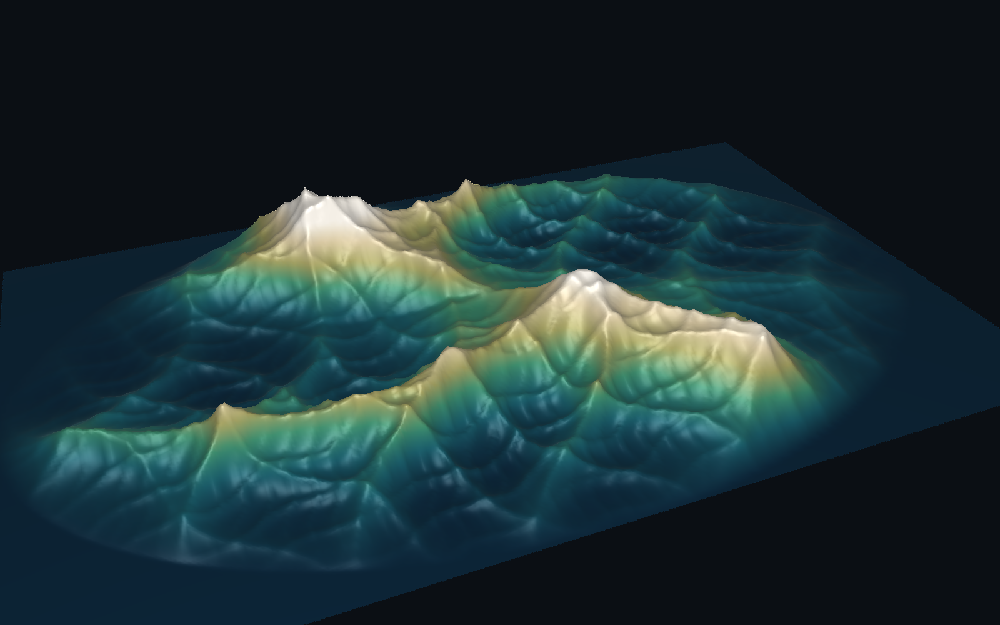 Build a terrain mesh](terrain.md)

[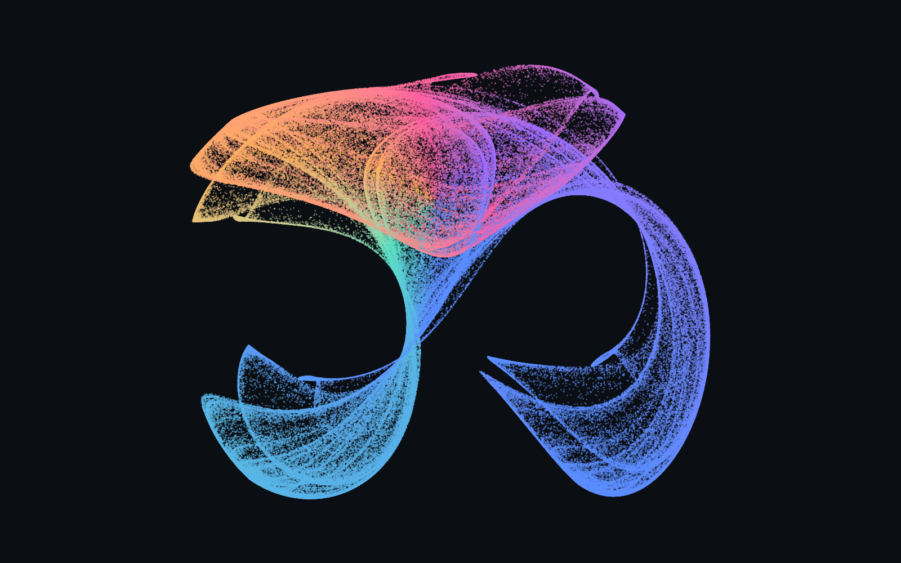 Plot a strange attractor](clifford.md)

[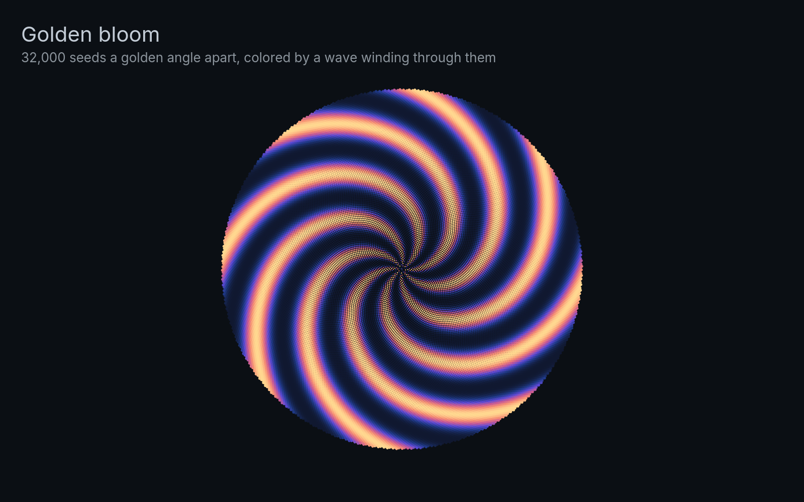 Color a spiral of points](bloom.md)

[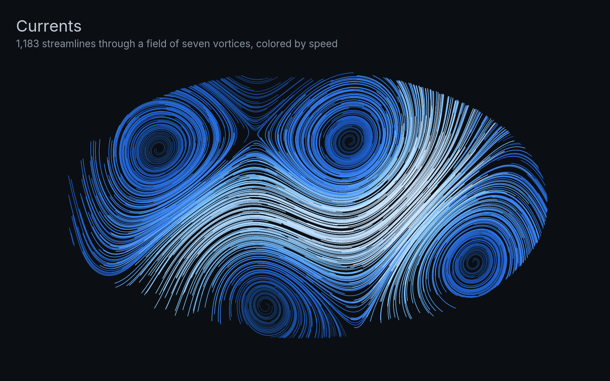 Trace streamlines](currents.md)

[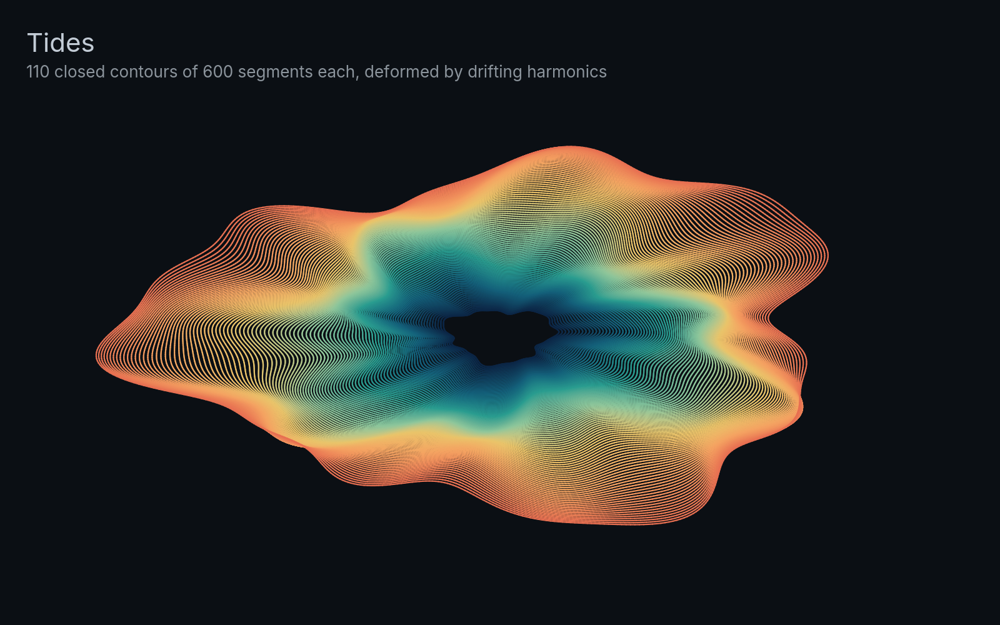 Draw nested contours](tides.md)
:::

## Reproduce a gallery image

For the TypeScript examples, install the [build prerequisites](https://github.com/lukelowry/latkit/blob/develop/CONTRIBUTING.md), then run these commands once from the repository root. Each example gives its own render command.

```sh
pnpm install --frozen-lockfile
cargo xtask wasm
cargo build --locked -p latkit-cli --profile cli
```

## Try the browser examples

From a checkout, run `cargo xtask examples --open` and choose an example.

| Example               | What to try                                                                                |
| --------------------- | ------------------------------------------------------------------------------------------ |
| Hawaiʻi one-line      | Zoom into a circuit, inspect the drafting paths, or toggle device symbols and bus numbers. |
| One-line              | Toggle breakers and flow animation on a generated schematic.                               |
| Power grids           | Explore synthetic cases on a map or globe.                                                 |
| Bus voltage monitor   | Zoom in on the voltage dip at John Day.                                                    |
| Setpoint and response | Compare a step command with the output on the same time axis.                              |
| Soft body             | Inspect the Stanford bunny mesh as it deforms.                                             |
| Orbits                | Move the pointer through the galaxy to magnify nearby bodies.                              |

[Browser example source](https://github.com/lukelowry/latkit/tree/develop/npm/examples).

```{toctree}
:hidden:

hawaii
wecc
voltage-dip
step-response
grid
texas
frequency
rerouting
fault
globe
helios
torus
terrain
clifford
bloom
currents
tides
```
