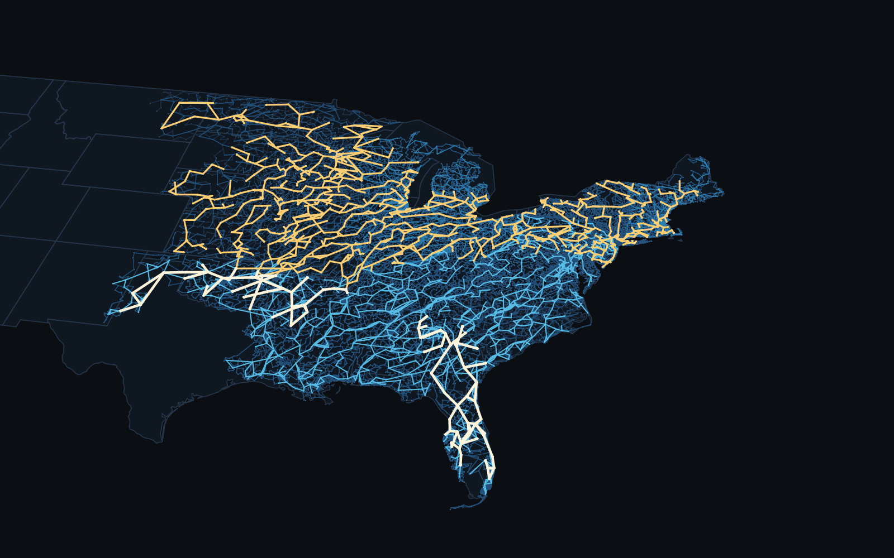
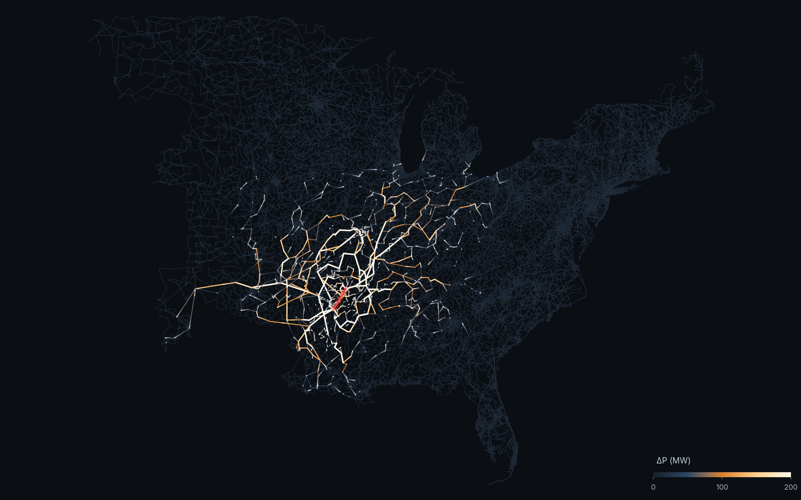
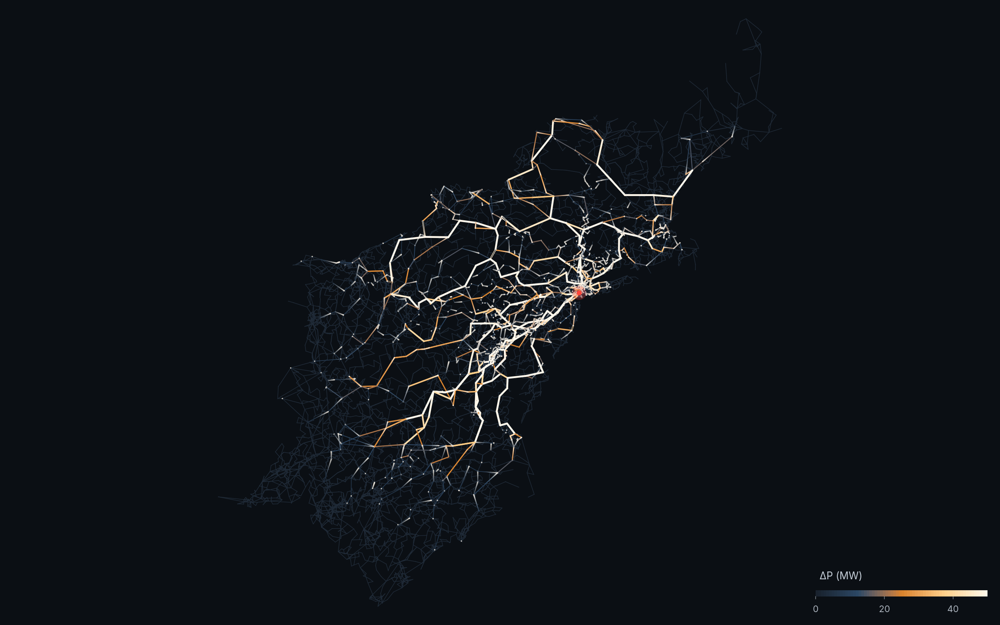
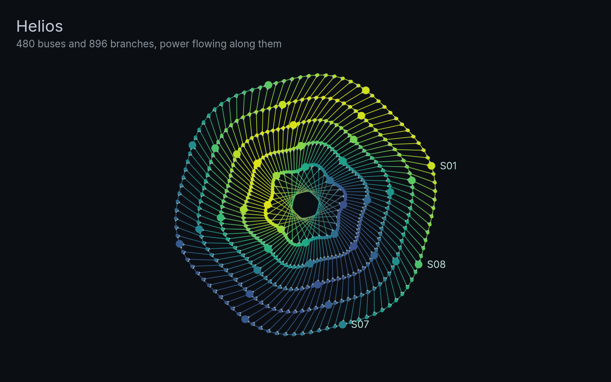
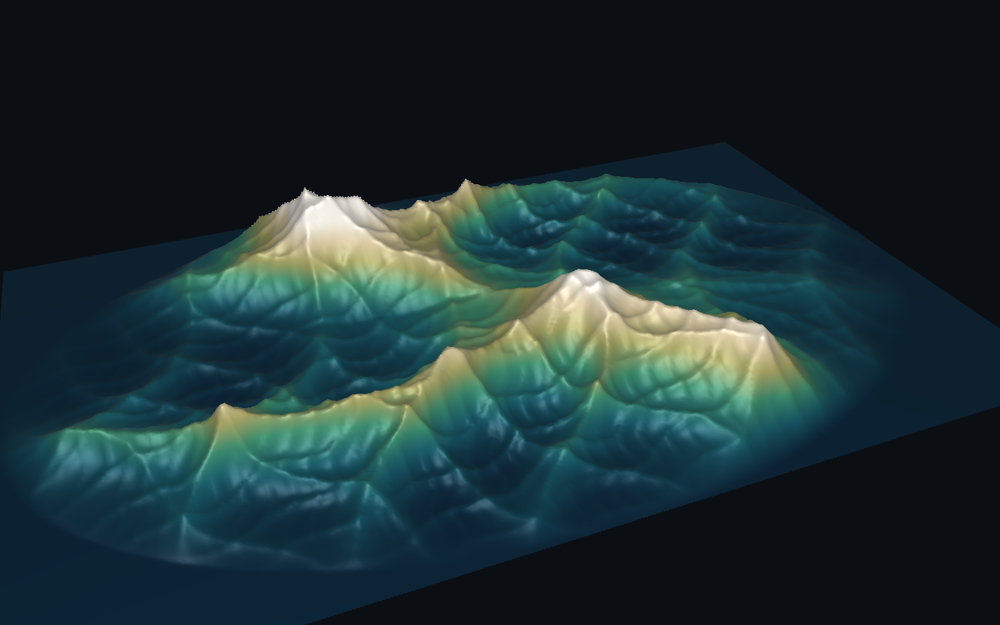
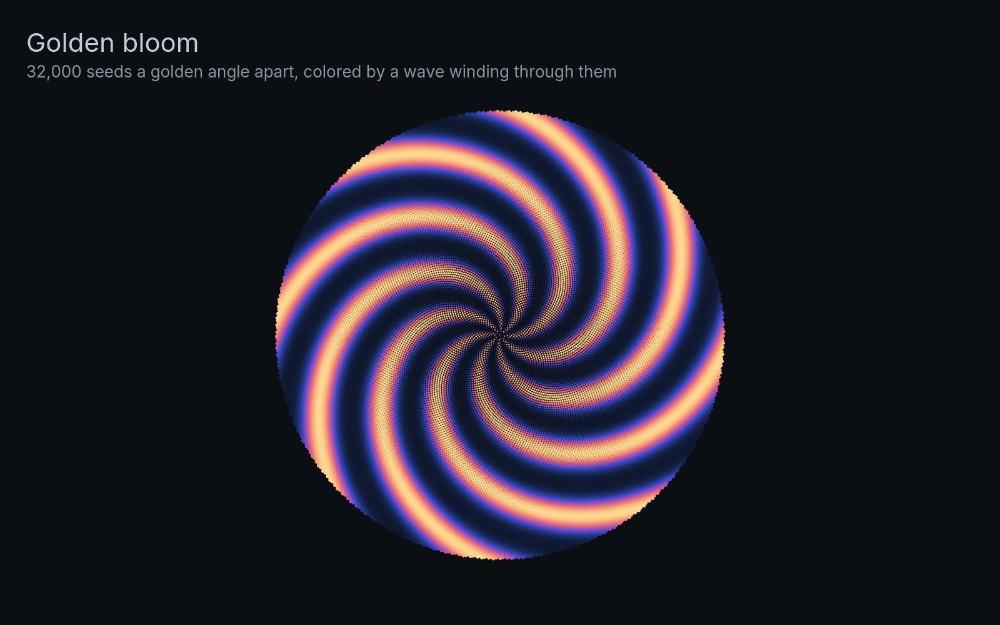
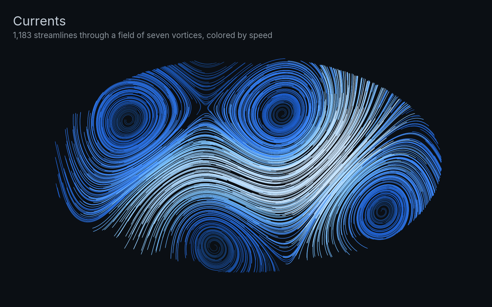
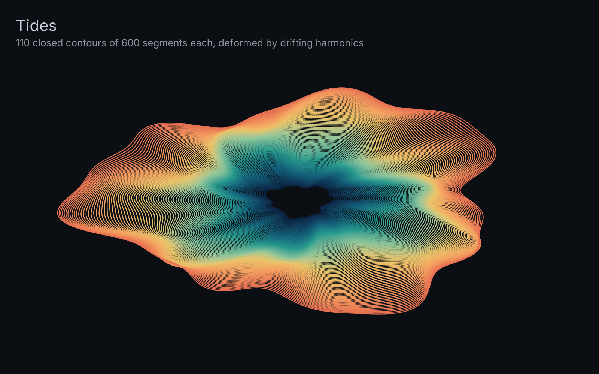

# Examples

The `latkit` command line draws every picture here. Each page shows the module that builds the
picture's datasets with `Data` and returns its scene. The
[example suite](https://github.com/lukelowry/latkit/tree/main/npm/examples) shows the same features
live in the browser.

:::{container} cards
[ ACTIVSg70k](grid.md)

[ ACTIVSg2000](texas.md)

[ ACTIVSg10k](frequency.md)

[ ACTIVSg70k rerouting](rerouting.md)

[ ACTIVSg25k fault](fault.md)

[ Globe](globe.md)

[ Diagram](diagram.md)

[ Helios](helios.md)

[ Torus silk](torus.md)

[ Terrain](terrain.md)

[ Clifford](clifford.md)

[ Golden bloom](bloom.md)

[ Currents](currents.md)

[ Tides](tides.md)
:::

```{toctree}
:hidden:

grid
texas
frequency
rerouting
fault
globe
diagram
helios
torus
terrain
clifford
bloom
currents
tides
```
