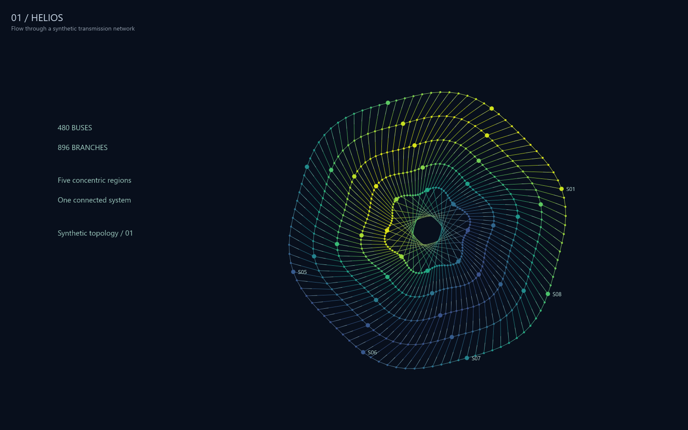
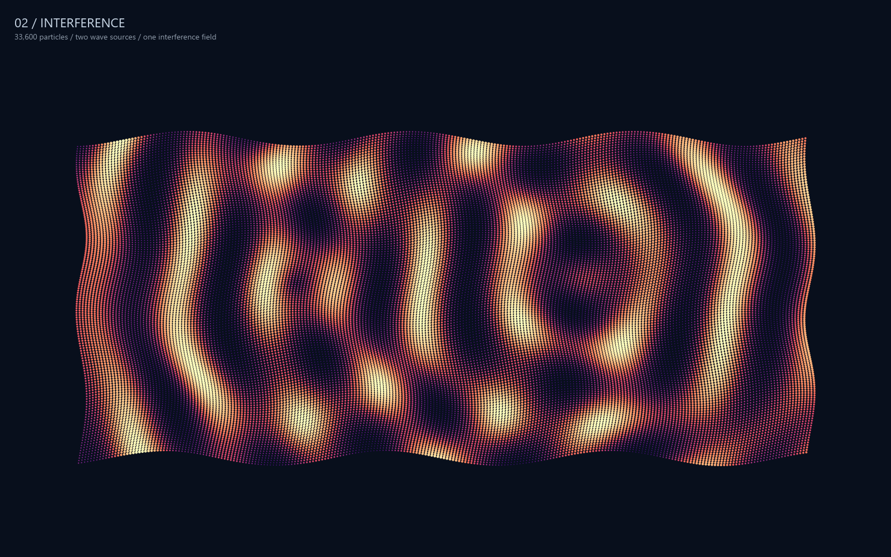
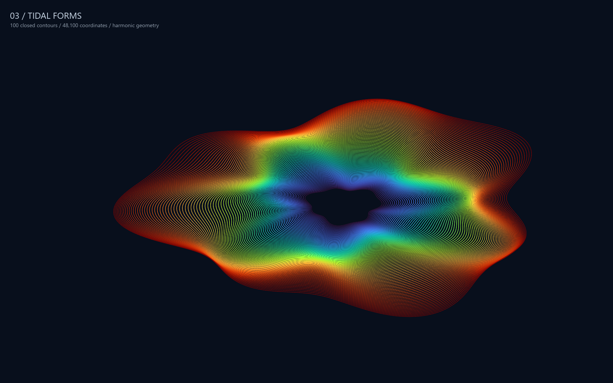

# CLI gallery

1600 × 1000 PNGs drawn by the `latkit` CLI, titles included, with no postprocessing. The data is
synthetic and generated locally.

## Helios

480 buses and 896 branches, with flowing edges, data-driven colors, and labels.



## Interference

33,600 particles colored and sized by the interaction of two radial waves.



## Tidal forms

100 closed contours of 48,100 coordinates, with harmonic deformations and a continuous palette.



## Reproduce

[`gallery.py`](gallery.py) writes each picture's scene (`NAME.json`) and dataset (`NAME.data.json`)
as latkit JSON, then renders them, every picture framing the same box with `--fit`:

```sh
cargo build --locked -p latkit-cli --profile cli
python examples/cli-gallery/gallery.py --cli target/cli/latkit --font C:/Windows/Fonts/segoeui.ttf
latkit render examples/cli-gallery/helios.json -d examples/cli-gallery/helios.data.json -o helios.png --size 1600x1000
```

These renders use Segoe UI; without `--font` the CLI uses system fonts, so text can differ.
